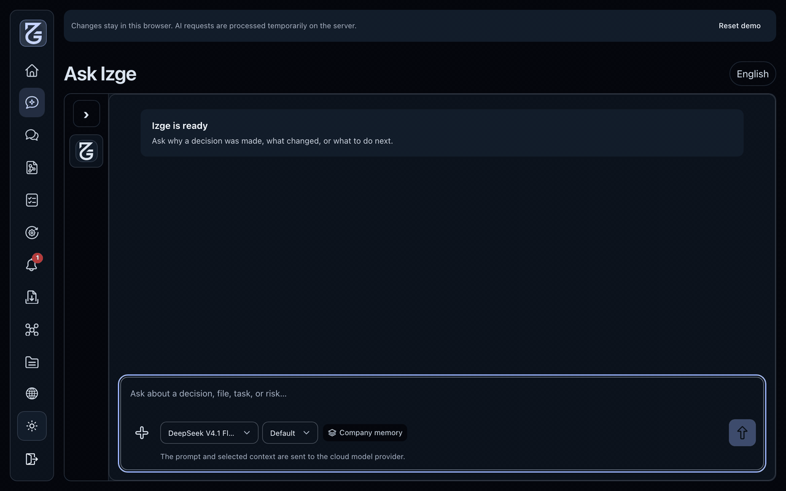
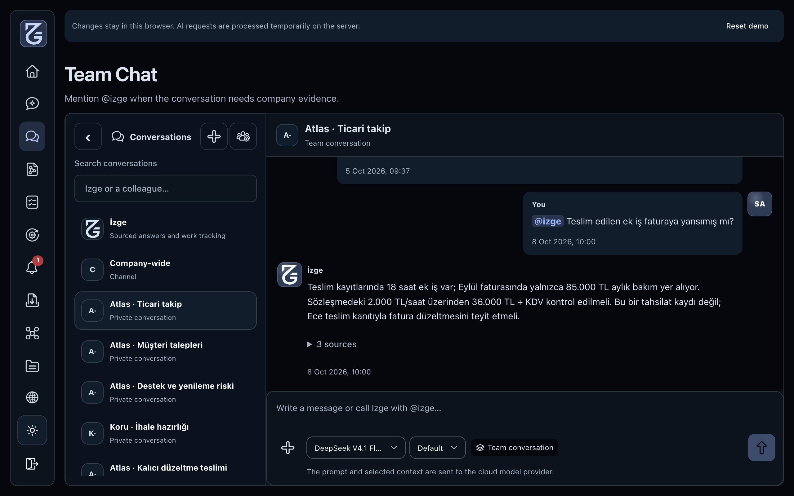
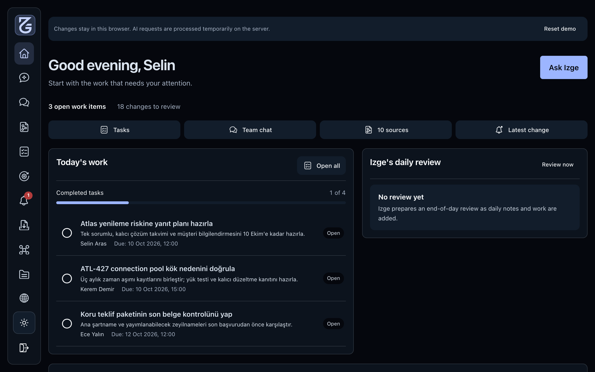

<p align="center">
  
</p>
<h1 align="center">İzge</h1>
<p align="center"><b>An on-premise AI coworker that knows how your company works.</b></p>
<p align="center">
  <a href="https://alperkartkaya.github.io/izge/demo/"></a>
  <a href="https://alperkartkaya.github.io/izge/"></a>
  
  
  
  <a href="LICENSE"></a>
</p>

Izge connects your contracts, documents, tasks, and team conversations into shared company memory and puts a colleague in the room who actually read all of them.

---

## Ask Izge

Ask direct questions in private, see how Izge checks company records step by step, and verify every answer from its original source.

<p align="center">
  
</p>

---

## Work Together in Team Chat

Mention `@izge` inside daily team channels to pull the right documents, past decisions, and numbers straight into the conversation.

<p align="center">
  
</p>

---

## Daily Review & Routines

Start the day with a clear brief of open tasks, follow-ups, and things that might otherwise slip through the cracks.

<p align="center">
  
</p>

---

## Quickstart

Requires **Python 3.11+** and **Node.js 20+**. Install dependencies, migrate the local database, and start both backend and frontend in one command:

```bash
./scripts/dev.sh
```

Then open `http://localhost:5173` (or run `./scripts/local-demo.sh` for Docker Compose).

---

## License

Released under the [MIT License](LICENSE).
